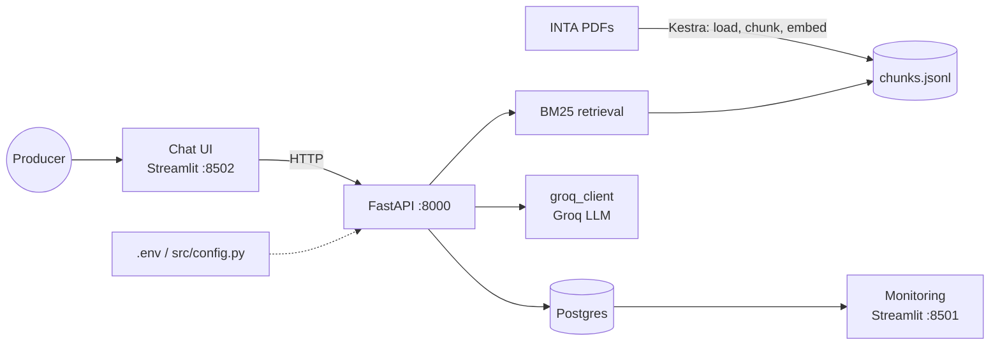
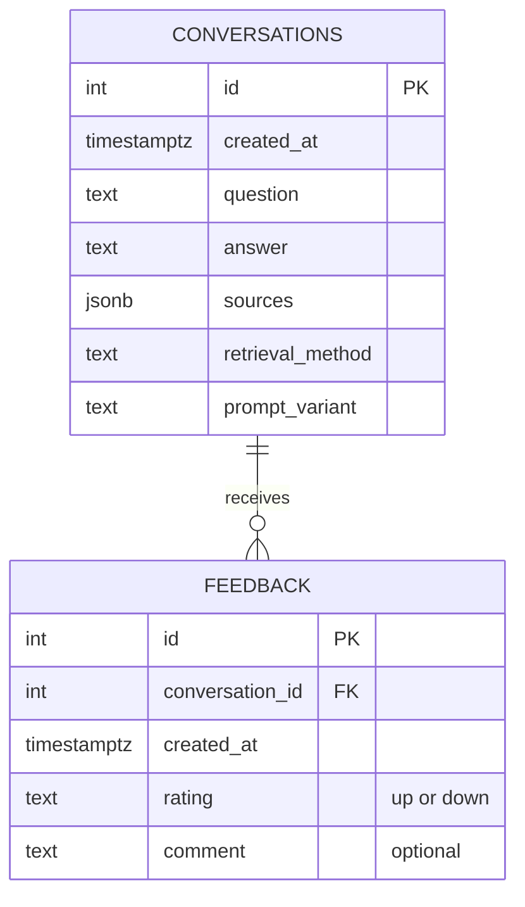

# 🐄 Cattle Raising Assistant

An AI-powered RAG (Retrieval-Augmented Generation) assistant that helps cattle producers quickly consult INTA's (Instituto Nacional de Tecnología Agropecuaria) technical studies on animal health, instead of manually searching through long, scattered PDF reports.

## 📑 Table of Contents

- [❓ Problem Description](#-problem-description)
- [🏗️ Project Architecture](#️-project-architecture)
- [🖥️ Technologies Used](#️-technologies-used)
- [📊 Retrieval Evaluation](#-retrieval-evaluation)
- [🤖 LLM Evaluation](#-llm-evaluation)
- [🗄️ Database Schema](#️-database-schema)
- [📈 Monitoring](#-monitoring)
- [💬 Sample Questions](#-sample-questions)
- [🖇️ Running the Project](#️-running-the-project)
- [🛠️ Reproducibility](#️-reproducibility)
- [🔁 When Groq Deprecates a Model](#-when-groq-deprecates-a-model)
- [🧪 Tests](#-tests)
- [🧱 Engineering Principles](#-engineering-principles)
- [🔮 Roadmap](#-roadmap)
- [🪐 About the Author](#-about-the-author)

## ❓ Problem Description

INTA (Argentina's national agricultural technology institute) publishes valuable technical research on cattle health — disease prevention, parasite identification, drought impact on livestock, vaccination guidelines, and more. This information is critical for producers, but it lives scattered across dozens of long, dense PDF reports that are not designed for quick lookup. A producer facing a concrete, time-sensitive question (e.g. "what tick species affect cattle in my region?" or "how does drought affect weight gain?") has to manually search through multiple documents to find a reliable, sourced answer.

This project addresses that gap by building an AI agent that:

- **Indexes** INTA's technical PDF reports on cattle health as a searchable knowledge base.
- **Retrieves** the most relevant passages for a producer's question, evaluated and chosen from multiple retrieval strategies rather than assumed.
- **Generates** a grounded, Spanish-language answer with explicit source citations (document and page), so producers can verify the information and go back to the original report if needed.
- **Stays within safe boundaries** for a health-adjacent domain: the assistant does not diagnose animals or prescribe treatment/dosage, and it explicitly recommends consulting a veterinarian for those cases.

## 🏗️ Project Architecture

The full pipeline:

1. **Data extraction**: source PDFs from INTA are processed and split into page-level chunks, stored as JSONL (`data/processed/chunks.jsonl`).
2. **Ingestion automation**: the extraction → chunking → embedding pipeline is orchestrated with **Kestra**, running inside Docker and sharing a volume with the API. It can be triggered manually or on a weekly schedule, instead of being run by hand in a notebook.
3. **Retrieval**: three strategies were implemented and evaluated — keyword search (BM25), vector search (Gemini embeddings), and hybrid search (Reciprocal Rank Fusion of both). See [Retrieval Evaluation](#-retrieval-evaluation).
4. **Generation**: a RAG module (`src/generation/rag.py`) builds a grounded prompt from the retrieved chunks and generates an answer with the Groq API (model configurable in `.env`, default `openai/gpt-oss-120b`), including citation formatting and domain safety rules. All Groq calls go through a single adapter (`src/generation/groq_client.py`).
5. **Evaluation**: both retrieval and generation are measured quantitatively rather than assumed — see the evaluation sections below, and the full write-up in [`docs/experiments.md`](docs/experiments.md).
6. **Interface**: a FastAPI application (`main.py`) exposes the assistant through `POST /ask` and `POST /feedback`, plus a `GET /health` liveness check, with interactive docs at `/docs`. A **Streamlit chat UI** (`src/ui/chat_app.py`) sits on top of the API for producers and live demos.
7. **Monitoring**: every conversation and piece of user feedback is logged to Postgres, visualized in a Streamlit dashboard. See [Monitoring](#-monitoring).
8. **Containerization**: the API, Postgres, the dashboard, the chat UI and Kestra all run together via a single `docker-compose.yml`.



## 🖥️ Technologies Used

- Python 3.x
- [uv](https://docs.astral.sh/uv/) — package and project management
- Google Gemini API — `gemini-embedding-2`, used only for vector search embeddings
- [Groq API](https://console.groq.com/) — `openai/gpt-oss-120b` by default (configurable), used for answer generation and LLM-as-a-judge evaluation (fast, free-tier friendly)
- [rank_bm25](https://pypi.org/project/rank-bm25/) — BM25 keyword retrieval
- [FastAPI](https://fastapi.tiangolo.com/) — HTTP interface (`POST /ask`, `POST /feedback`, `GET /health`)
- [PostgreSQL](https://www.postgresql.org/) — stores conversations and user feedback
- [Streamlit](https://streamlit.io/) — chat UI and monitoring dashboard
- [pytest](https://docs.pytest.org/) — automated tests (offline, no API keys needed)
- [Kestra](https://kestra.io/) — orchestrates and automates the ingestion pipeline
- Docker & Docker Compose — the full stack (API, Postgres, dashboard, Kestra) runs as one unit

## 📊 Retrieval Evaluation

Three retrieval strategies were first compared against a 10-question ground truth set, using Hit Rate@5 and MRR as metrics:

| Method | Hit Rate@5 | MRR |
|---|---|---|
| Keyword (BM25) | 100% | **0.817** |
| Vector (Gemini embeddings) | 90% | 0.587 |
| Hybrid (RRF of keyword + vector) | 100% | 0.770 |

**BM25 keyword search was chosen for production**, based on the highest MRR. This is a domain-specific finding: the ground truth questions use precise technical vocabulary that tends to match the source text literally, favoring lexical search over semantic search in this corpus. Hybrid search was evaluated but not selected — full reasoning, and the initial BM25 bug that was found and fixed along the way, are documented in [`docs/experiments.md`](docs/experiments.md).

**How confident are these numbers?** With only 10 questions, a 100% hit rate is statistically compatible with a true rate as low as 72% (95% Wilson interval). To get more trustworthy estimates, the ground truth was expanded to **42 questions covering all four documents**, and every metric is now reported with a 95% confidence interval:

| Method (42 questions) | Hit Rate@5 | 95% CI | MRR | 95% CI |
|---|---|---|---|---|
| Keyword (BM25) | 90.5% | [78%, 96%] | 0.724 | [0.61, 0.83] |
| Vector / Hybrid | *to re-run with `GEMINI_API_KEY`* | | | |

The new questions were drafted with AI assistance and automatically checked against the chunk text; they are marked `"authoring": "ai_assisted"` in `data/evaluation/retrieval_ground_truth.json`.

## 🤖 LLM Evaluation

Generated answers are scored using an **LLM-as-a-judge** approach: for each question, a judge model (Groq, configurable with `GROQ_JUDGE_MODEL`) rates the generated answer on two axes — *relevance* (does it answer the question) and *groundedness* (is every claim backed by the retrieved context, with no invented information). Two prompt variants were compared over the original 10-question set, with `llama-3.3-70b-versatile` (since retired by Groq) as generator and judge:

| Prompt | Relevant | 95% CI | Grounded | 95% CI |
|---|---|---|---|---|
| A (detailed — numbered rules + citation example) | 90% | [60%, 98%] | 100% | [72%, 100%] |
| B (concise — same constraints, one short paragraph) | 90% | [60%, 98%] | 100% | [72%, 100%] |

The intervals show why a 10-question tie says little. Re-run it with the current model on all 42 questions with `uv run python -m src.evaluation.evaluate_llm`: results are cached per **prompt + generation model + judge model**, so a model change never reuses old judgments.

**The two prompts tied exactly.** Prompt A was kept for production: with equal measured quality, the detailed prompt's worked citation example is expected to generalize better to questions outside this 10-question sample, where citation formatting is more likely to drift without an example to anchor it. One question was not answered relevantly by either prompt — noted as a known limitation rather than something worth over-fitting the prompt to fix from a single case. Full reasoning is in [`docs/experiments.md`](docs/experiments.md).

## 🗄️ Database Schema

Every question the API answers is logged, and every piece of feedback a user gives is linked back to the conversation it's about:



- **`conversations`**: one row per `/ask` request — the question, the generated answer, its cited sources (as JSON), and which retrieval method / prompt variant produced it (useful if that ever changes, or if a bug silently switches it).
- **`feedback`**: one row per `/feedback` request, referencing the `conversations` row it rates. A conversation can receive zero, one, or more feedback entries.

## 📈 Monitoring

Two things happen automatically as the API is used:

1. **Every conversation is logged** to the `conversations` table (see [Database Schema](#️-database-schema)).
2. **User feedback is collected** via `POST /feedback` (thumbs up/down + optional comment), stored in the `feedback` table.

A **Streamlit dashboard** (`src/monitoring/dashboard.py`, served at `:8501`) reads live from Postgres and renders 6 charts:

1. Conversations per day
2. Feedback: positive vs. negative
3. Retrieval method used (flags it visually if anything other than BM25 is ever used)
4. Prompt variant used (same idea, for prompt A vs. B)
5. Average answer length per day
6. Most frequently asked questions

The dashboard uses a green/yellow color theme (`.streamlit/config.toml`) matching the agricultural domain of the project.

## 💬 Sample Questions

Questions to try in the chat UI (http://localhost:8502) or against `POST /ask` (via `/docs` or curl). **The assistant always answers in Spanish**, regardless of whether the question is asked in English or Spanish — this is a deliberate design choice, since the target users (Argentine cattle producers) are Spanish speakers; the bilingual list below is meant for demoing the assistant to a non-Spanish-speaking audience.

### On-topic (grounded in the INTA documents)

| # | English | Español |
|---|---|---|
| 1 | What tick species can affect cattle? | ¿Qué especies de garrapatas pueden afectar al ganado? |
| 2 | How does drought affect cattle weight gain? | ¿Cómo afecta la sequía a la ganancia de peso del ganado? |
| 3 | What diseases does bovine alphaherpesvirus type 1 cause? | ¿Qué enfermedades causa el alfaherpesvirus bovino tipo 1? |
| 4 | Does ivermectin have antiviral effects in cattle? | ¿Tiene la ivermectina efectos antivirales en el ganado? |
| 5 | What symptoms indicate a tick infestation in cattle? | ¿Qué síntomas indican una infestación de garrapatas en el ganado? |

### Off-topic (unrelated to the project — should trigger the "insufficient information" safeguard, not a hallucinated answer)

| # | English | Español |
|---|---|---|
| 1 | What's the capital of France? | ¿Cuál es la capital de Francia? |
| 2 | Can you write me a poem about the ocean? | ¿Podés escribirme un poema sobre el océano? |
| 3 | How do I fix a JavaScript syntax error? | ¿Cómo soluciono un error de sintaxis en JavaScript? |

The off-topic set is a quick manual check that the assistant stays grounded: it should say the available documents don't cover the topic, rather than answering from the model's general knowledge.

## 🖇️ Running the Project

### With Docker (recommended — runs the full stack)

```bash
docker compose up --build
```

This starts all five services:

| Service | URL | What it is |
|---|---|---|
| `ui` | http://localhost:8502 | **Chat interface** — start here |
| `api` | http://localhost:8000 | FastAPI — redirects to `/docs` |
| `postgres` | localhost:5432 | Conversation + feedback storage |
| `dashboard` | http://localhost:8501 | Streamlit monitoring dashboard |
| `kestra` | http://localhost:8080 | Ingestion pipeline orchestration UI |

A `.env` file with the required keys (see [Reproducibility](#️-reproducibility)) must exist in the project root before running this.

### API only, without Docker

```bash
uv run uvicorn main:app --reload
```

Open **http://127.0.0.1:8000/docs** for the interactive Swagger UI, or send a request directly:

```bash
curl -X POST http://127.0.0.1:8000/ask \
  -H "Content-Type: application/json" \
  -d '{"question": "¿Qué efectos tuvo la sequía sobre la ganancia de peso de los bovinos?"}'
```

(Note: without Docker, Postgres/Monitoring won't be available unless you run it separately.)

## 🛠️ Reproducibility

### Prerequisites

- [Python](https://www.python.org/downloads/) 3.14 or higher (`uv` can install it for you)
- [uv](https://docs.astral.sh/uv/) — Python package and project manager
- [Docker Desktop](https://www.docker.com/products/docker-desktop/) — to run the full stack
- A Google Gemini API key ([Google AI Studio](https://aistudio.google.com/)) — used for embeddings only
- A Groq API key ([console.groq.com](https://console.groq.com)) — used for generation and evaluation, free tier, no credit card required

### Setup

```bash
git clone https://github.com/Camila20197/cattle-raising-assistant.git
cd cattle-raising-assistant
uv sync
```

Create your `.env` from the template and fill in your keys:

```bash
cp .env.example .env
```

| Variable | Required | Default | Purpose |
|---|---|---|---|
| `GEMINI_API_KEY` | yes | — | Embeddings (vector search, ingestion) |
| `GROQ_API_KEY` | yes | — | Generation and LLM-as-a-judge |
| `GROQ_GENERATION_MODEL` | no | `openai/gpt-oss-120b` | Model that writes the answers |
| `GROQ_JUDGE_MODEL` | no | same as generation | Model that scores answers in the evaluation |
| `GENERATION_MAX_TOKENS` | no | `4096` | Answer budget (reasoning models use part of it to think) |
| `RETRIEVAL_TOP_K` | no | `5` | Chunks sent to the model |
| `POSTGRES_USER` / `POSTGRES_PASSWORD` / `POSTGRES_DB` | for Docker | — | Monitoring database |

### Running the evaluations

```bash
# Retrieval evaluation (keyword vs vector vs hybrid), with 95% confidence intervals
uv run python -m src.evaluation.evaluate_retrieval
uv run python -m src.evaluation.evaluate_retrieval --methods keyword   # no API key needed

# LLM evaluation (prompt A vs prompt B, LLM-as-a-judge)
uv run python -m src.evaluation.evaluate_llm
uv run python -m src.evaluation.evaluate_llm --sample-size 10          # quicker run

# Inspect what each retrieval method returns for one question
uv run python -m src.evaluation.compare_retrieval "¿Qué es la tristeza bovina?"
```

> `evaluate_llm.py` is resumable: results are saved after every question, so if it's ever interrupted (rate limits, network issues), re-running the same command picks up where it left off. Cached results are keyed by prompt **and** by generation/judge model, so changing a model starts a fresh run instead of replaying stale judgments.

All logs and evaluation output are in English. The assistant's answers and the chat UI are in Spanish by design (see [Sample Questions](#-sample-questions)).

### Running the ingestion pipeline

The pipeline (`src/ingestion/run_ingestion.py`) is orchestrated by a Kestra flow (`cattle_health_ingestion`). With the stack running (`docker compose up`), open the Kestra UI at `http://localhost:8080`, open the flow, and click **Execute** — or wait for its weekly schedule.

## 🔁 When Groq Deprecates a Model

Groq retires models periodically (e.g. `llama-3.3-70b-versatile` was shut down on 2026-08-16). The project is built so this is a configuration change, not a code change:

1. **Symptom**: `POST /ask` returns **503** with a message like *"Groq model '…' is not available … set GROQ_GENERATION_MODEL"*, and the chat UI shows "the language model is not available". `GET /health` shows which model is configured.
2. **Check** the [Groq deprecations page](https://console.groq.com/docs/deprecations) for the recommended replacement, and the [models page](https://console.groq.com/docs/models) to confirm it is active.
3. **Change** `GROQ_GENERATION_MODEL` (and `GROQ_JUDGE_MODEL` if you set it) in `.env`.
4. **Restart**: `docker compose up -d --force-recreate api ui` (or restart `uvicorn`).
5. **Re-run the LLM evaluation**: the cache is keyed by model, so it re-generates and re-judges everything for the new model.

## 🧪 Tests

```bash
uv sync               # installs the dev dependencies (pytest) too
uv run pytest
```

The suite runs **offline and for free**: Groq, Gemini and Postgres are replaced by fakes. It covers configuration, chunking, BM25 and fusion, retrieval metrics and confidence intervals, prompt building, Groq error translation (including a decommissioned model), the evaluation cache (regression test for the stale-judgment bug), the API endpoints (including the 503 on a retired model) and the chat UI's citation formatting.

One test is marked `xfail` on purpose: it documents a known chunking bug (the overlap can start mid-word) that will be fixed together with a re-ingestion — see the Roadmap.

## 🧱 Engineering Principles

The v0.2.0 refactor applied classic software-engineering principles (information hiding, low coupling, high cohesion, SOLID, usability heuristics). [`docs/engineering-improvements.md`](docs/engineering-improvements.md) maps each change to the principle behind it.

## 🔮 Roadmap

Ideas for future improvement, beyond what's built:

- ~~**Improve the interface**~~: done in v0.2.0 — a Streamlit chat UI (`src/ui/chat_app.py`). Next step: usability tests with real producers.
- **Fix mid-word chunk overlap**: re-ingest with word-aligned overlaps and regenerate the ground-truth chunk IDs (tracked by an `xfail` test).
- **Human review of the ground truth**: the 32 AI-assisted evaluation questions should be reviewed by a domain expert.
- **Improve ingestion to pull updates automatically from INTA's website**: today, ingestion re-processes whatever PDFs are already in `data/raw/`. A more complete version would have the Kestra flow check INTA's publications page for new reports and download them automatically, so the knowledge base stays current without anyone manually adding files.
- **Best practices**: evaluate document re-ranking and query rewriting (hybrid search is already evaluated — see [Retrieval Evaluation](#-retrieval-evaluation)).
- **Cloud deployment**: deploy to Google Cloud Platform, provisioned with Terraform, with dbt for any warehouse-side transformations. This would also unblock a live BigQuery + Looker Studio connection for Monitoring, instead of the local Postgres + Streamlit setup used today.
- **API deployment to Cloud Run**: a deployment of the API to Google Cloud Run was attempted but did not succeed — the build completed successfully and the same image runs correctly via Docker Compose, but the revision failed with a generic "Container import failed" error at the Cloud Run platform level, with no application logs produced (the container never reached the point of starting Python). Getting this working is expected to be revisited in the future, with more time to investigate the platform-level cause.

## 🪐 About the Author

I am a Data Processing and Analytics Engineering student at the Universidad Nacional de Entre Ríos (UNER) in Argentina, with experience in Python, SQL, and data architecture. This project combines that background with an interest in applying LLMs and RAG to a real, practical problem for agricultural producers.

👩‍💻 Connect with me on LinkedIn: [Camila Durand](https://www.linkedin.com/in/camila-ayelen-durand/)
